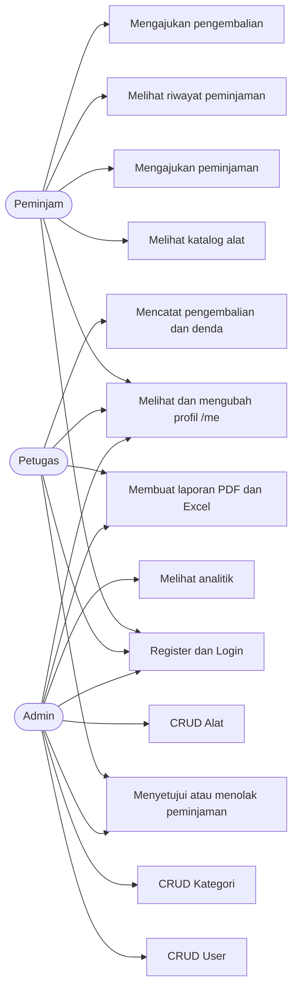
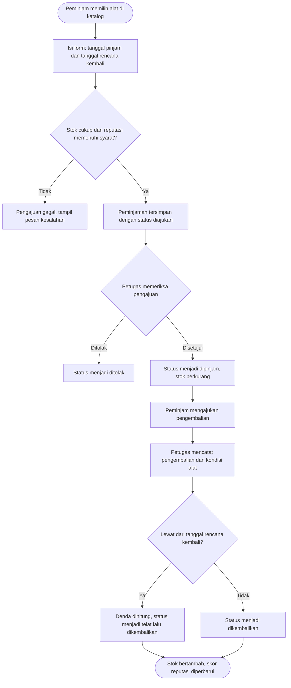
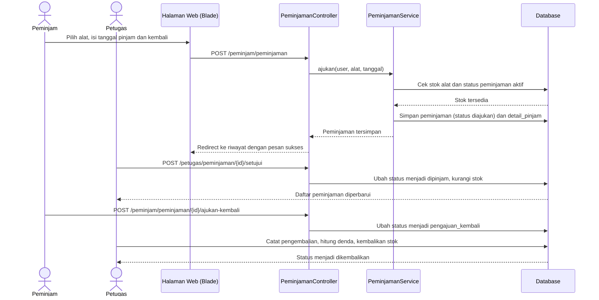
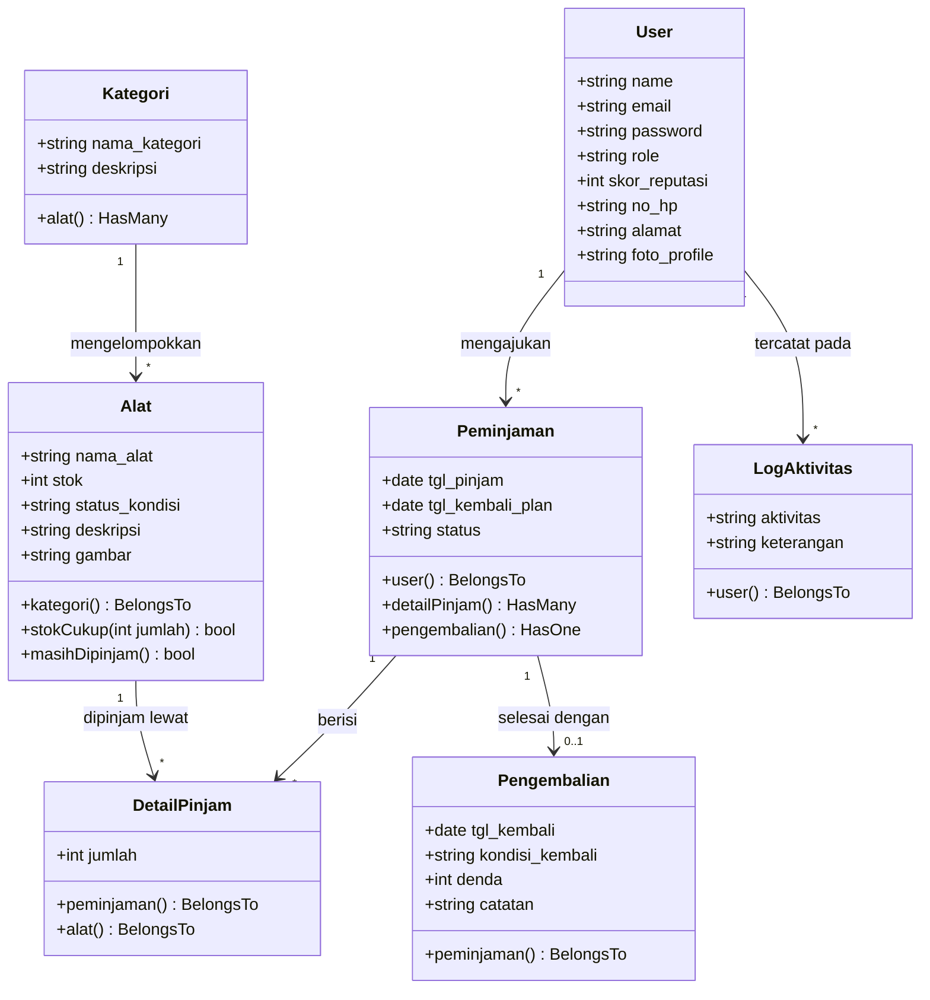
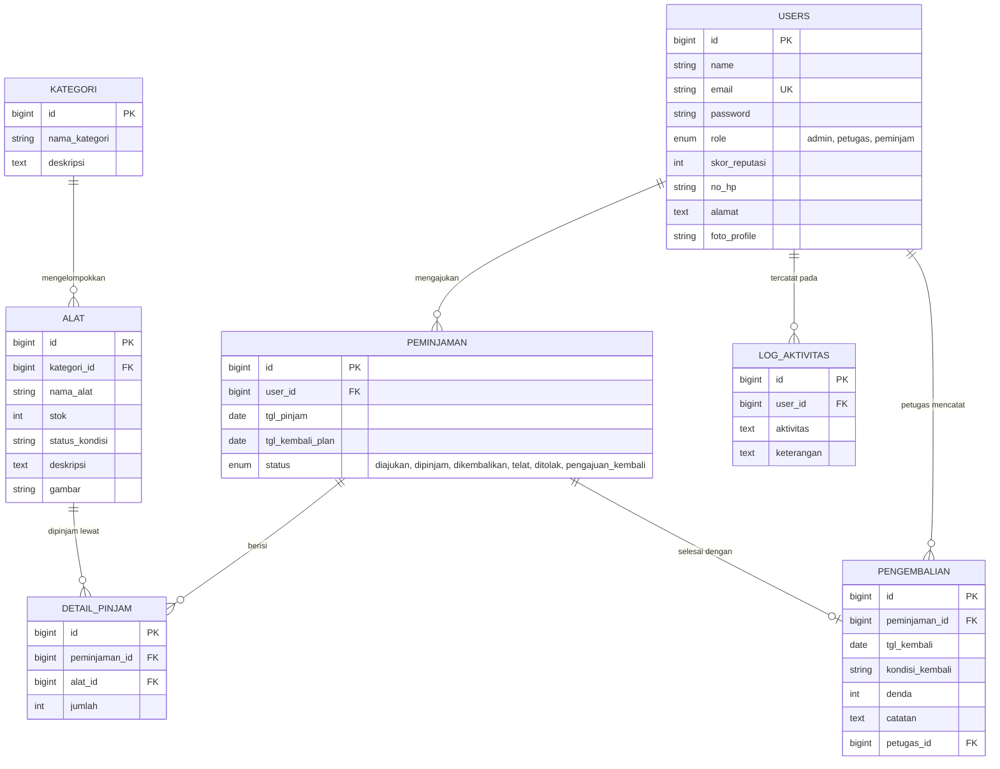

# Perancangan Aplikasi Peminjaman Alat (SiPinjam)

Dokumen ini merangkum perancangan SiPinjam sesuai aplikasi yang benar-benar dibuat: diagram use case, diagram aktivitas, diagram sequence, diagram class, dan ERD. Struktur tabel dan relasi mengikuti migrasi di `backend/database/migrations`, sedangkan aktor dan aktivitas mengikuti route dan peran di aplikasi.

## 1. Diagram Use Case

Tiga aktor memakai sistem dengan hak akses berbeda. Admin mengelola data master, Petugas memproses peminjaman dan pengembalian, Peminjam mengajukan peminjaman.

## 2. Diagram Aktivitas

Alur aktivitas pengajuan peminjaman sampai selesai digambarkan sebagai flowchart di `DOKUMENTASI_LENGKAP_ALUR_DAN_LOGIKA.md` bagian 5 (Alur Bisnis Utama). Ringkasnya: Peminjam memilih alat dan tanggal, sistem memeriksa stok dan skor reputasi, Petugas menyetujui atau menolak, alat berstatus dipinjam, lalu Peminjam mengajukan pengembalian dan Petugas mencatat pengembalian beserta denda bila terlambat.

## 3. Diagram Sequence

Urutan interaksi untuk proses peminjaman dari pengajuan sampai pengembalian tercatat.

## 4. Diagram Class

Class utama adalah model Eloquent di `backend/app/Models` beserta relasinya.

## 5. ERD (Entity Relationship Diagram)

Tujuh tabel inti hasil migrasi dan relasinya.

Status peminjaman mengikuti kolom enum pada migrasi terakhir: diajukan, dipinjam, dikembalikan, telat, ditolak, dan pengajuan_kembali.
